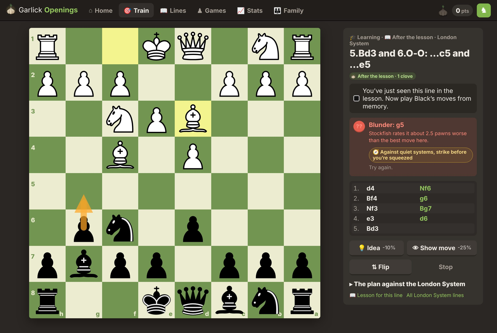
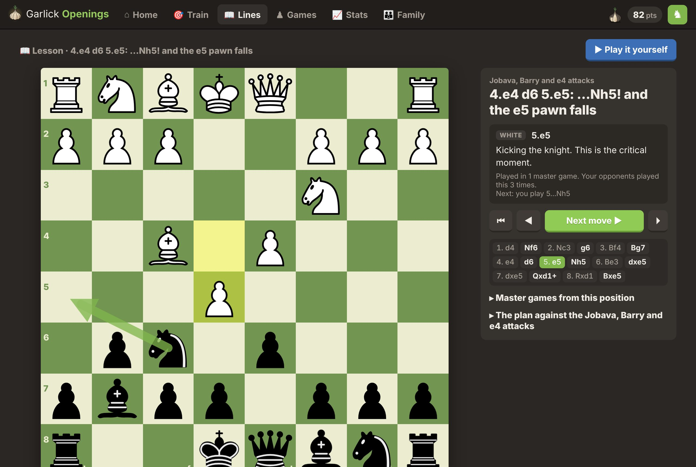
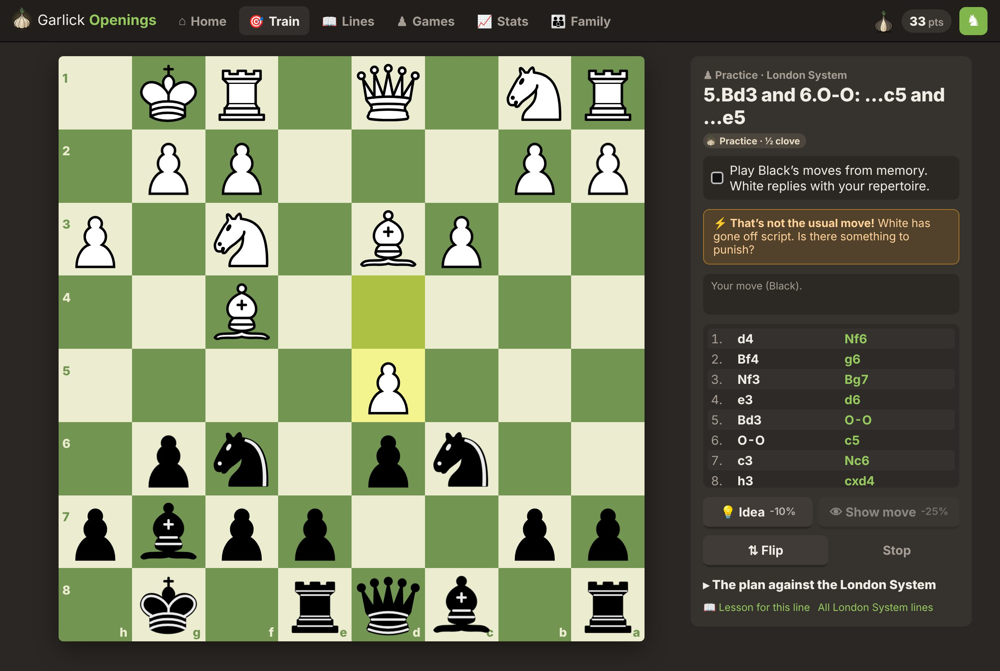
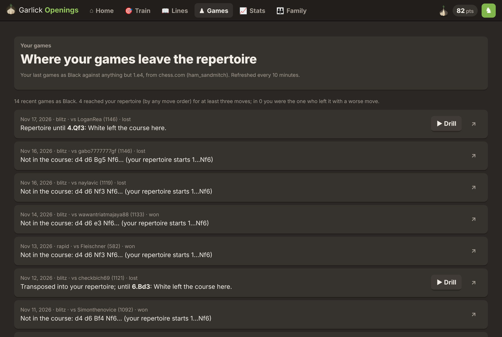
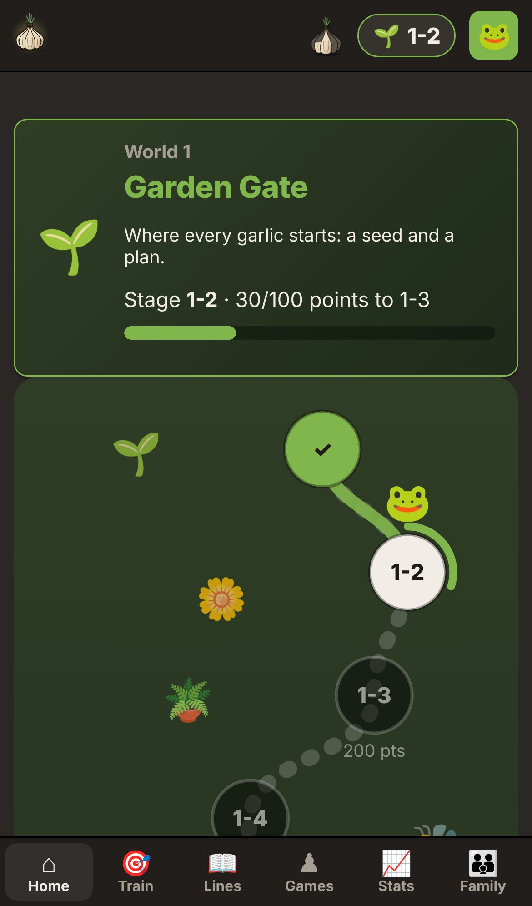
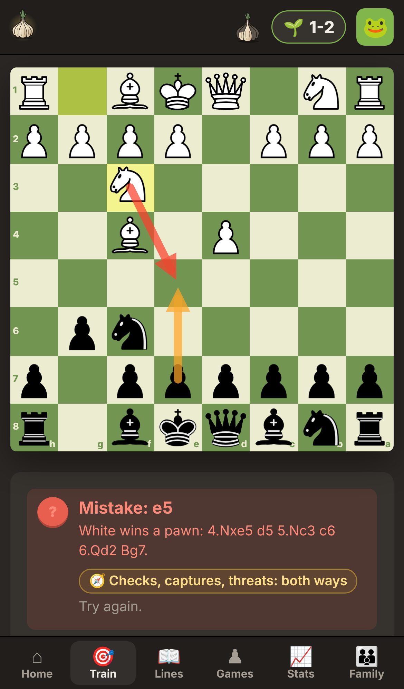
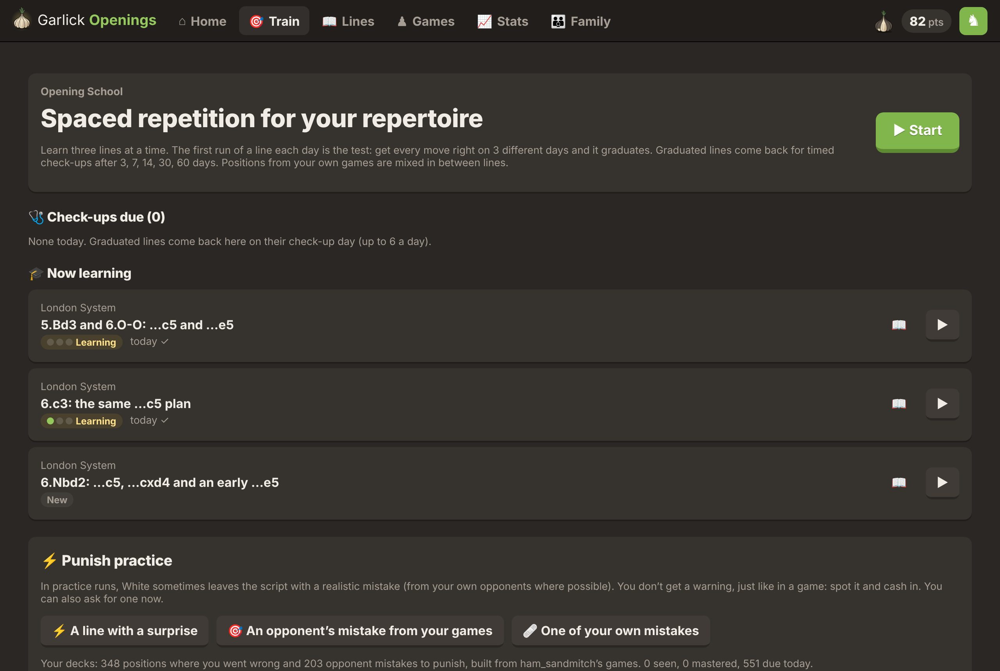

# Garlick Openings

An openings trainer for the family, a sibling of
[Garlick Endgames](https://endgames.garlick.ca). It starts with one course: a
**King's Indian Defence** repertoire for Black, built around the openings
ham_sandmitch actually meets on chess.com. You learn each line with an
explanation for every move. You then play the lines from memory on a spaced
schedule. White sometimes slips in a realistic mistake for you to punish.
Every wrong move is explained twice: the concrete reason it fails, and the
opening principle behind it.

**Live: https://openings.garlick.ca**. One sign-in covers both Garlick
sites: log in on either one and you're logged in on the other.



## What's in it

* **42 lines in 8 chapters**, ordered by how often you meet each system:
  London (50 of your games) · Colle and e3 systems (51) · Jobava, Barry and
  e4 attacks (33) · quiet c4 systems and the Fianchetto (39) · the
  main-line King's Indian (27) · Trompowsky and Torre (14) · flank openings
  (60) · early tricks such as 1.d4 Nf6 2.e4?! Nxe4. Each chapter has a plan card covering
  the structure, the ideas and what happened in your games.
* **12 principles** (let White take the centre then hit it, pawn breaks,
  the g7 bishop, the pawn shield, stop e4-e5, checks/captures/threats...).
  Every move note and every mistake links to one of them.
* **Learn, then recall:** a new line opens as a step-through lesson. One
  sentence per move, arrows, master statistics, and how often your opponents
  played each White move. Then you play Black's moves yourself.
* **Opening School (spaced repetition):** three lines at a time. The first
  run of a line each day is the test. Three clean days graduate it. Check-ups
  then come after 3, 7, 14, 30 and 60 days, **timed like blitz** (5 s a move
  by default). A miss resets the count; a failed check-up sends the line back.
* **Judging without an engine on the site:** Stockfish evaluated every
  legal Black move in every position of the course when it was built.
  * A move as good as the repertoire move (or a well-played master move) is
    "good, but not your repertoire".
  * Worse moves are graded Inexact, Inaccuracy, Mistake or Blunder, using
    Lichess's scale.
* **Explanations, two levels:**
  * **The concrete reason**, taken from Stockfish's line. "White wins a pawn:
    10.Bxe5", "It allows mate: 9.Nxc7+ Kf8 10.Rd8#", "4.e5 kicks your knight",
    "You could have won a pawn: 2...Nxe4".
  * **The principle behind it**, such as "Leave your king's pawn shield alone"
    or "Pawn breaks are your counterplay".

  The first miss explains; the second reveals the repertoire move.
* **Surprise mistakes:** in practice runs, White sometimes plays a realistic
  mistake instead of the book move: dropping a centre pawn, leaving e4 or d4
  loose, or forgetting to recapture. You aren't warned; spot it and punish
  it. There are 149 such moments, each checked by Stockfish, and you can ask for one
  on demand.
* **Your games:**
  * **Two personal decks** from ham_sandmitch's 269 King's Indian games: 348
    positions where you went wrong, and 203 where your opponent did (you
    cashed in on 102 of those during the game). They are spaced like the lines
    and mixed in between them.
  * **The "Games" page** fetches your recent chess.com games and shows where
    each one left the repertoire, even after a transposition.
* **The end of every line is a plan question** ("the centre is locked: where
  do you attack?"), because the analysis shows your first mistake comes
  around move 11, when the opening turns into a middlegame.
* **The Garlick Path:** points move you along a map like a puzzle game's:
  stage 1-1, 1-2 … 1-10, then world 2. There are ten themed worlds, from the
  Garden Gate 🌱 to the Garlick Crown 👑.
  * Points come from finishing exercises, harder challenges (×1 to ×2),
    clean play, speed, combos of clean runs, punishing surprises, and your
    daily streak.
  * Every exercise earns 1–3 ⭐.
  * The Elo-style **opening rating** is separate: it measures strength; the
    path measures effort.
* From the endgame site:
  * the **daily Garlick bulb**, **streak shields** woven from extra cloves,
    streak **repair** with a double bulb, and **golden cloves**;
  * **36 badges**, the **family board**, and "keep going or done for today?";
  * the phone-first layout with a bottom tab bar.

| Lesson | Surprise! | Your games |
|---|---|---|
|  |  |  |

| The Garlick Path | Phone | Opening School |
|---|---|---|
|  |  |  |

## How it works

```
course/    The course, written by hand: principles.js and kings-indian.js
           (annotated PGN: {#principle note} after a move, (variation) for
           a tempting wrong move and why it's worse)
scripts/   build-course.mjs: validates the course and adds masters statistics,
           Stockfish evaluations and the surprise mistakes -> shared/course.json
           build-index.mjs: the small index the server needs
analysis/  chess.com game analysis (python-chess + Stockfish + Lichess masters),
           which builds the personal decks and shared/insights.json
shared/    Code used by both sides: judging, explanations, curriculum, rating,
           cloves, streaks, scoring, badges, the PGN parser
server/    Fetch-style API (accounts, runs, school, family board, masters
           explorer proxy, chess.com games) + Node server on node:sqlite
worker/    Cloudflare Worker entry + D1 adapter (same API)
client/    React + Vite: board, bulb, trainer, lessons, pages
deploy/    The built Worker bundle (token-free deploys)
docs/      DESIGN, RESEARCH, ROADMAP, REUSE, the game report, screenshots
```

* **Accounts and sign-in are shared with Garlick Endgames.** The Worker binds
  two D1 databases.
  * `AUTH_DB` is the endgame site's database. Its `users` and `sessions`
    tables hold the family accounts and the shared sign-in. This site writes
    sessions there, plus the shared account fields (name, avatar, colour,
    rating, password).
  * `DB` is this site's own database: profiles, runs, the School, the bulb
    and badges.
  * Both Workers set `COOKIE_DOMAIN=garlick.ca`, so the `garlick_session`
    cookie works on every *.garlick.ca site.

  Locally, without `AUTH_DB_FILE`, one SQLite file holds everything.
* No engine or AI runs on the site. Every judgement comes from data built
  ahead of time: Stockfish 16 (every legal move at depth 12, the main
  candidates at depth 16), and the Lichess masters database.

## Run it locally

Requires **Node 22.13 or newer**.

```bash
npm install
npm run build        # builds the client into client/dist
npm start            # app + API on http://localhost:8787
npm run dev          # hot reload on http://localhost:5173
npm test             # unit + API tests (vitest)
node scripts/e2e-openings.cjs /tmp/shots http://localhost:8787   # Playwright walkthrough
```

| Variable | Default | Purpose |
|---|---|---|
| `PORT` | `8787` | HTTP port (local server) |
| `DB_FILE` | `data/openings.db` | This site's SQLite file |
| `AUTH_DB_FILE` | *(none)* | The endgame site's SQLite file, to share its accounts |
| `INVITE_CODE` | *(empty)* | If set, new accounts need this code |
| `COOKIE_DOMAIN` | *(empty)* | e.g. `garlick.ca`: share the sign-in with the other Garlick sites |
| `EXPLORER_URL` | Lichess masters | Alternative opening explorer endpoint |
| `LICHESS_TOKEN` | *(empty)* | A Lichess personal token (no scopes): unlocks club-player statistics in lessons. On Cloudflare it's a Worker secret |

Behind an HTTPS proxy, start Node with `NODE_USE_ENV_PROXY=1` so the
explorer and chess.com requests go through it.

### Rebuilding the course

Edit `course/kings-indian.js`, then:

```bash
npm run course       # needs Stockfish (/usr/games/stockfish or STOCKFISH=...)
```

The build fails on illegal moves, unknown principle tags, a missing plan
question, or two different repertoire moves for the same position. It warns
when Stockfish rates a repertoire move more than 0.45 pawns below the best
move. Engine and masters results are cached in `scripts/.cache`.

### Re-running the game analysis

See [analysis/README.md](analysis/README.md). It writes the personal deck
(`shared/personal/<username>.json`), `shared/insights.json` and
`course/opponent-moves.json`, which is used to prefer surprise mistakes your
real opponents made.

## Deploying

As for the endgame site: `npm run bundle` writes `deploy/worker.js`. Commit
and push it, and the Cloudflare connector fetches it from this public repo at
the exact commit, checks its SHA-256 and uploads it. The upload carries two
D1 bindings (`DB` = `garlick-openings`, `AUTH_DB` = `garlick-endgames`) and
the custom domain `openings.garlick.ca`. Details are in
[deploy/README.md](deploy/README.md). With an API token,
`CLOUDFLARE_API_TOKEN=... npm run deploy` does the same.

## Credits

* Chess pieces: "cburnett" by Colin M.L. Burnett (BSD option), via Wikimedia Commons.
* Master statistics: the [Lichess](https://lichess.org) opening explorer.
* Evaluations: [Stockfish](https://stockfishchess.org) 16 (GPLv3), run at build time only.
* Move legality: [chess.js](https://github.com/jhlywa/chess.js).
